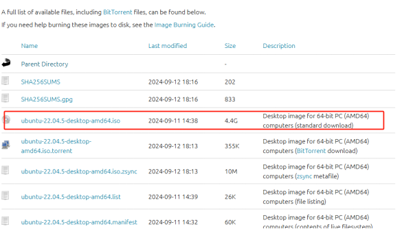
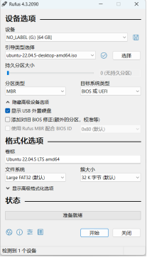
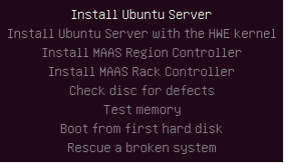
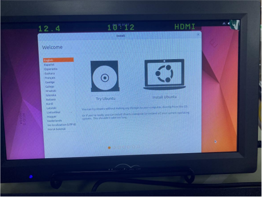
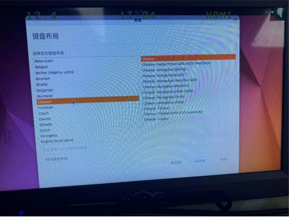
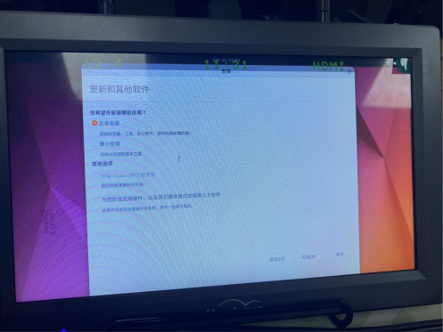
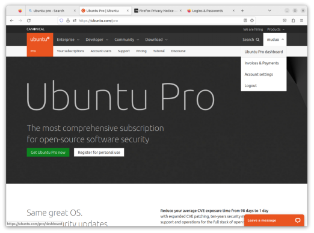
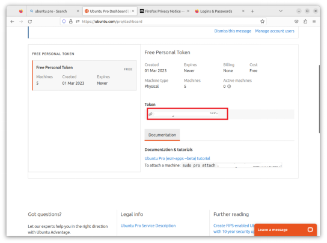
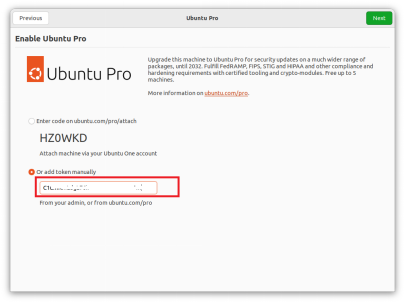

# ASEToolBox工具箱

<div align="left">
  
  
  
</div>

**基于 MATLAB/Simulink 的实时仿真工具箱 —— 将 Simulink 模型一键部署到 ASE型实时仿真机**

---
> 📚 文档导航：<br>
> [总入口（导航仓库）](https://github.com/zqhkd/flight-control-toolbox) ｜ [English](https://github.com/zqhkd/flight-control-toolbox/blob/main/README_EN.md)<br>
> **本工具箱：** [中文](./README.md) ｜ [English](./README_EN.md)<br>
> **相关工具箱：** [AFCToolBox 飞控快速开发](https://github.com/zqhkd/AFCToolBox) ｜ [English](https://github.com/zqhkd/AFCToolBox/blob/main/README_EN.md)
---
##  1. ASEToolBox概述

ASEToolBox 是由 ACG 团队基于 MATLAB/Simulink 开发的一套实时仿真工具箱，配套 ASE型实时仿真机使用。用户在 Simulink 中完成模型（userModel.slx）搭建后，只需点击 Simulink 窗口中的 ASE 菜单栏，即可完成模型的自动部署、运行、停止与状态查询，无需手动处理交叉编译、传输与远程启动等繁琐步骤。现正式将工具箱源代码完整开源，欢迎大家使用、交流与二次开发。
##  2. 功能特性

1、一键自动部署（AutoDeploy）：将 Simulink 用户模型自动编译并部署到实时仿真机

2、运行控制：通过 ASE 菜单一键运行（Run ASETarget）、停止（Stop ASETarget）仿真程序

3、状态查询（Query）：实时查询下位机仿真程序的运行状态

4、硬实时运行环境：基于 Ubuntu 22.04 LTS + PREEMPT-RT 实时内核（5.15.0-1087-realtime）

5、多硬件平台支持：支持凌华工控机、EMB3118、EMB3942、EMB4940 等主板平台

6、可视化状态反馈：运行各阶段状态在 Simulink 窗口左下角状态栏实时显示
##  3. 系统架构
```
┌─────────────────────────────┐         SSH / Ethernet          ┌──────────────────────────────┐
│   上位机（开发机）        │  ───────────────────────────▶  │   下位机（ASE系列实时仿真机）    │
│  Windows / 银河麒麟 Kylin V10│                                │  Ubuntu 22.04 LTS            │
│  + MATLAB/Simulink          │                                │  / 银河麒麟 Kylin V10 SP1     │
│  + ASEToolBox 工具箱         │  ◀───────────────────────────  │  + PREEMPT-RT 实时内核        │
│  SSH 客户端（PuTTY / OpenSSH）│        状态回传 / 日志          │  + ASETarget 运行时           │
└─────────────────────────────┘                                └──────────────────────────────┘
```
## 4. 环境要求

### 上位机（开发机）

| 软件                      | 说明                               |
| ----------------------- | -------------------------------- |
| Windows 10/11           | 传统开发主机，完整功能支持                    |
| **银河麒麟 Kylin V10（桌面版）** | ✅ 国产信创环境，MATLAB + Simulink 全链路可用 |
| **统信 UOS V20（桌面版）**     | ✅ 国产信创环境，MATLAB + Simulink 全链路可用 |
| MATLAB/Simulink         | R2023a+，用于搭建用户模型并调用 ASEToolBox   |
| MobaXterm / PuTTY       | Windows 下 SSH 远程访问下位机            |
| OpenSSH Client          | 银河麒麟 / 统信 UOS 下原生 SSH 客户端（已预装）   |
|                         |                                  |
### 下位机（ASE系列实时仿真机）

| 项目 | 版本 |
| --- | --- |
| 操作系统 | Ubuntu 22.04.5 LTS Desktop |
| **国产系统** | **银河麒麟 Kylin V10 SP1（服务器版）** ✅ |
| 实时内核 | 5.15.0-1087-realtime（Ubuntu Pro realtime-kernel）/ 银河麒麟原生 PREEMPT-RT 内核 |
| VSCode | 1.99 |
| GCC / G++ | 11.4.0（build-essential） |
| GDB | 12.1 |
| Make | 4.3 |
| CMake | 3.22.1 |
## 5. 快速开始

### 5.1. 获取并解压工程

将 `ASEProject2.01.yymmdd.zip` 解压至上位机的 `D:\ASE\ASEProject` 目录。

### 5.2. 添加工具箱到 MATLAB 路径

将 `ASEToolBox` 目录及其所有子目录添加到 MATLAB 工作路径中：

```matlab
addpath(genpath('D:\ASE\ASEProject\ASEToolBox'));
savepath
```
也可以在 MATLAB 中通过 **主页 → 设置路径 → 添加并包含子文件夹** 完成。
### 5.3 部署 ASETarget 到下位机
使用 MobaXterm 登录下位机，将 `ASETarget` 整个目录拷贝至下位机的：

/home/administrator/projects/

> 注意：`projects` 文件夹需在下位机 `/home/administrator/` 路径下手动新建，ASETarget 必须放在该目录中才能正常运行 ASE 模型。
---
### 5.4 运行仿真
1. 在 MATLAB/Simulink 中打开你自己编写的用户模型文件 `userModel.slx`；
2. 在 Simulink 窗口中点击 **ASE 菜单栏**：
   - **AutoDeploy**：自动部署模型到下位机；
   - **Run ASETarget**：运行仿真程序；
   - **Stop ASETarget**：停止仿真程序；
   - **Query**：查询运行状态。
3. 各种状态会在 Simulink 窗口**左下角状态栏**显示（字体较小，请留意）。
### 5.5 更换上位机网络时的注意事项
在不同电脑之间更换网线（即更换上位机）时，需要先在上位机执行一次 SSH 连接确认，防止后续烧录程序出错：

**Windows 上位机**：
1. `Win + R` 打开运行窗口，输入 `cmd` 打开命令终端；
2. 执行：
```bash
plink -ssh administrator@192.168.0.7
```

**银河麒麟 / 统信 UOS 上位机**（使用 OpenSSH 或 Linux 版 putty-tools）：
```bash
ssh administrator@192.168.0.7    # OpenSSH（首次连接会自动提示确认主机指纹）
# 或
plink -ssh administrator@192.168.0.7   # putty-tools 提供的 Linux 版 plink
```

> IP 地址请替换为实际下位机地址，上位机与下位机 IP 建议设置为同一网段，如 `192.168.0.xx`。

### 6.下位机环境搭建
 下位机完整安装流程主要步骤概要如下：
### 6.1 安装 Ubuntu 22.04
1. 从 [Ubuntu 官网](https://releases.ubuntu.com/jammy/) 下载 `ubuntu-22.04.5-desktop-amd64.iso`；

2. 使用 Rufus 制作启动 U 盘（勾选"显示 USB 外接硬盘"，以 ISO 模式写入）；

3. 插入下位机，开机按 `DEL`/`F12`/`ESC` 进入 BIOS，选择 `UEFI: Generic Flash Disk` 启动，选择 **Install Ubuntu**；

4. 安装过程中注意：
   - 地域请选择中国大陆城市，避免软件源指向国外导致下载失败；
   - 安装完成重启前请先拔掉安装 U 盘。

### 6.2 下载Ubuntu的配置
(1)进入安装界面，选择install Ubuntu,进行ubuntu的安装

(2)点击右下角的next，设置语言配置,这里根据个人需求配置中文或是英文。

(3)下一步选择正常安装

(4)安装类型，选择第一个，卸载Ubuntu22.04.5LTS并重新安装

(5)用户可根据需求自行配置ubuntu账户密码。
### 6.3 配置国内软件源并安装 SSH

编辑 `/etc/apt/sources.list`，替换为国内镜像源：

```
deb https://mirrors.ustc.edu.cn/ubuntu/ jammy main restricted universe multiverse
deb https://mirrors.ustc.edu.cn/ubuntu/ jammy-updates main restricted universe multiverse
deb https://mirrors.ustc.edu.cn/ubuntu/ jammy-backports main restricted universe multiverse
deb https://mirrors.ustc.edu.cn/ubuntu/ jammy-security main restricted universe multiverse
```

然后安装并启动 SSH 服务：

```bash
sudo apt update
sudo apt install openssh-server
sudo systemctl start ssh
sudo systemctl enable ssh
```
### 6.4 安装 PREEMPT-RT 实时内核（Ubuntu Pro）
实时内核需要 Ubuntu Pro 授权（个人及小规模商业用途最多 5 台设备免费）：

1. 到 [https://ubuntu.com/pro](https://ubuntu.com/pro) 注册 Ubuntu One 账号并订阅，获取 token；

2. 在下位机上绑定设备（首次启动向导或"软件和更新 → Livepatch"中输入 token）；


3. 启用并安装实时内核：

```bash
# 确认系统版本为 Ubuntu 22.04 LTS
lsb_release -a

# 启用实时内核仓库
sudo pro enable realtime-kernel --access-only
sudo apt update

# 安装指定版本实时内核（若仓库中不存在则安装 ubuntu-realtime 元包）
sudo apt install -y linux-image-5.15.0-1078-realtime linux-headers-5.15.0-1078-realtime

# 配置 GRUB 默认启动实时内核
grep -E "^menuentry" /boot/grub/grub.cfg | cut -d "'" -f 2
sudo sed -i 's/^GRUB_DEFAULT=.*/GRUB_DEFAULT="Advanced options for Ubuntu>Ubuntu, with Linux 5.15.0-1078-realtime"/' /etc/default/grub
sudo update-grub
sudo reboot
```

4. 重启后验证：

```bash
uname -r                                     # 应显示 5.15.0-1078-realtime
grep PREEMPT_RT /boot/config-$(uname -r)     # 应返回 CONFIG_PREEMPT_RT=y
grep CONFIG_HIGH_RES_TIMERS /boot/config-$(uname -r)   # 应返回 =y
```
### 6.5 安装开发工具链与 VSCode

```bash
sudo apt install build-essential gdb cmake

# 安装 VSCode 1.99（固定版本，避免自动升级）
wget https://update.code.visualstudio.com/1.99.0/linux-deb-x64/stable -O vscode_1.99.0_amd64.deb
sudo apt install ./vscode_1.99.0_amd64.deb
sudo apt-mark hold code
```

并在 VSCode 中安装 **C/C++**、**CMake Tools**、**CodeLLDB**（或 Native Debug）等扩展。

### 6.6 辅助工具（可选）


```bash
# 串口调试助手
sudo apt install cutecom
sudo usermod -a -G dialout $USER

# 中文语言包与 Fcitx 输入法
sudo apt-get install language-pack-zh-hans
sudo apt-get install fcitx fcitx-googlepinyin
```

### 6.7 国产操作系统下位机环境搭建（银河麒麟 Kylin V10 SP1）

银河麒麟 Kylin V10 SP1 服务器版已完成 ASEToolBox 下位机适配验证，作为 Ubuntu + PREEMPT-RT 的国产化替代方案，具备同等硬实时性能。

**① 系统安装**
银河麒麟 V10 SP1 的 ISO 安装包可从麒麟官网下载，安装流程与 Ubuntu 类似，注意：
- 推荐选择服务器版（含 PREEMPT-RT 内核包）；
- 分区时预留 `/home` 目录，用于存放 `ASETarget` 运行时；
- 安装完成后执行 `sudo apt update && sudo apt upgrade` 确保系统最新。

**② 配置软件源并安装 SSH**
银河麒麟的软件源需配置为官方源或国内镜像源：

```bash
# 备份并替换软件源
sudo cp /etc/apt/sources.list /etc/apt/sources.list.bak
sudo tee /etc/apt/sources.list << 'EOF'
deb http://archive.kylinos.cn/kylin/KYLIN-ALL/ bionic main restricted universe multiverse
deb http://archive.kylinos.cn/kylin/KYLIN-ALL/ bionic-updates main restricted universe multiverse
deb http://archive.kylinos.cn/kylin/KYLIN-ALL/ bionic-security main restricted universe multiverse
EOF

sudo apt update
sudo apt install -y openssh-server
sudo systemctl enable ssh
sudo systemctl start ssh
```

**③ 安装 PREEMPT-RT 实时内核**
银河麒麟 V10 SP1 原生提供 PREEMPT-RT 实时内核包，直接安装即可（无需 Ubuntu Pro 订阅）：

```bash
# 查看可用的实时内核
apt-cache search kylin-realtime

# 安装实时内核（内核版本以实际搜索结果为准）
sudo apt install -y linux-image-4.19.90-23.8.v2101.ky10.x86_64.realtime linux-headers-4.19.90-23.8.v2101.ky10.x86_64.realtime

# 更新 GRUB 配置
sudo update-grub
sudo reboot
```

重启后验证：

```bash
uname -r                                           # 应包含 realtime 字样
grep PREEMPT_RT /boot/config-$(uname -r)          # 应返回 CONFIG_PREEMPT_RT=y
```

**④ 安装开发工具链**
银河麒麟基于 Ubuntu 18.04，部分包名与 Ubuntu 22.04 略有差异：

```bash
sudo apt install -y build-essential gdb cmake git

# 安装 GCC 9（麒麟 V10 默认 GCC 版本较低，推荐手动升级）
sudo apt install -y gcc-9 g++-9
sudo update-alternatives --install /usr/bin/gcc gcc /usr/bin/gcc-9 90
sudo update-alternatives --install /usr/bin/g++ g++ /usr/bin/g++-9 90
```

**⑤ VSCode 安装**
银河麒麟可直接使用 VSCode 的 .deb 安装包：

```bash
wget https://update.code.visualstudio.com/1.99.0/linux-deb-x64/stable -O vscode_amd64.deb
sudo dpkg -i vscode_amd64.deb
sudo apt --fix-broken install -y
```

**⑥ 上位机 SSH 工具适配（国产 OS / Windows 通用）**

ASEToolBox 部署脚本默认使用 `plink`（PuTTY 命令行工具）执行 SSH 操作，在国产 OS 下有两种替代方案：

- **方案 A：使用 OpenSSH（推荐）** — 银河麒麟 / 统信 UOS 已预装，将 MATLAB 路径切换脚本中的 `plink` 替换为 `ssh` 即可；
- **方案 B：安装 putty-tools** — 国产 OS 仓库中可直接安装：
  ```bash
  sudo apt install -y putty-tools   # 提供 Linux 版 plink 命令
  ```
  安装后 `plink` 命令可用，与 Windows 下用法一致。

**⑦ 上位机 MobaXterm 替代方案**
银河麒麟 / 统信 UOS 下推荐使用以下工具替代 MobaXterm 的 SSH + SFTP 功能：

| 功能 | Windows | 银河麒麟 / 统信 UOS |
| --- | --- | --- |
| SSH 终端 | MobaXterm / PuTTY | **VSCode Remote SSH** / Termius / 系统终端 ssh |
| SFTP 文件传输 | MobaXterm 内置 | VSCode SFTP 扩展 / **FileZilla** / `scp` 命令 |
| 首次连接指纹确认 | `plink -ssh ...` | `ssh administrator@<IP>`（首次自动提示确认） |

> ASEToolBox 的 MATLAB 部署脚本已适配 OpenSSH 方案，若使用 OpenSSH 上位机，脚本自动识别并切换 SSH 客户端。

---

##  7. 目录结构

```
ASEProject/
├── ASEToolBox/        # MATLAB/Simulink 工具箱（本仓库）
│   ├── ...            # Simulink 菜单、部署脚本、S-Function 等
├── ASETarget/         # 下位机实时运行程序（需拷贝至下位机 ~/projects/）
└── userModel.slx      # 用户模型示例
```

> 以上为参考结构，请以实际发布包为准。

##  8. 常见问题

**Q：部署/烧录程序时报 SSH 连接错误？**

A：更换上位机或网线后，需先执行一次 SSH 连接确认主机指纹。Windows 上位机使用 `plink -ssh administrator@<下位机IP>`；银河麒麟 / 统信 UOS 上位机使用 `ssh administrator@<下位机IP>`（OpenSSH）或 Linux 版 `plink`（`sudo apt install putty-tools`）。

**Q：无法下载安装软件包？**

A：检查下位机网络连接，并确认 `/etc/apt/sources.list` 已替换为国内镜像源；安装系统时地域不要选择香港等境外城市。

**Q：如何确认实时内核已生效？**

A：执行 `uname -r` 应显示 `5.15.0-1087-realtime`，且 `grep PREEMPT_RT /boot/config-$(uname -r)` 返回 `CONFIG_PREEMPT_RT=y`。

**Q：仿真状态在哪里看？**

A：Simulink 窗口左下角状态栏会显示部署/运行/停止等各阶段状态，字体较小，请留意。

## 📧 9. 作者与联系方式 (Contact)

本项目由中山大学ACG团队开发与维护。 如果您对代码实现有疑问、发现 Bug 或有进一步的学术合作意向，欢迎通过以下方式联系：

  个人邮箱 (Permanent): zqhkd@qq.com 
  
---
* **环境要求**：MATLAB R2023a或更高版本。
* **版权**： 中山大学 航空航天学院. 遵循 MIT 协议。