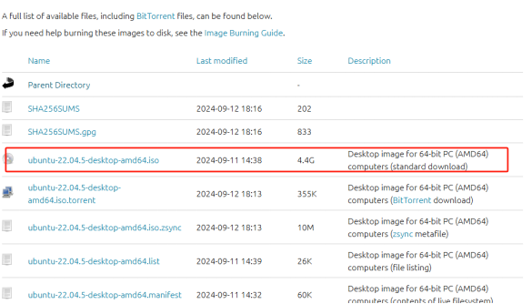
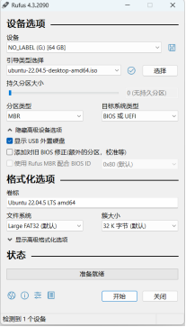
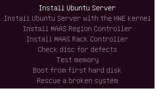
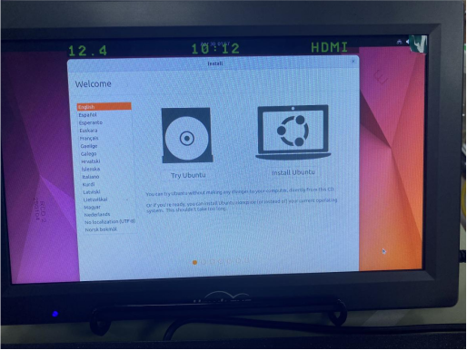
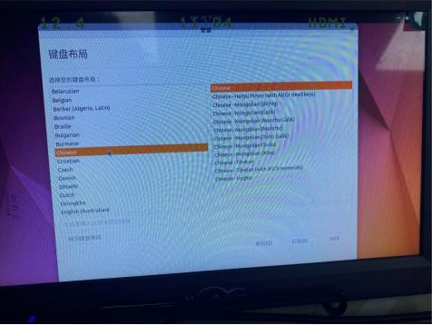
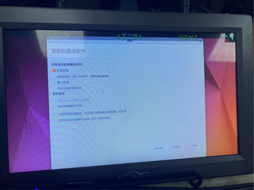
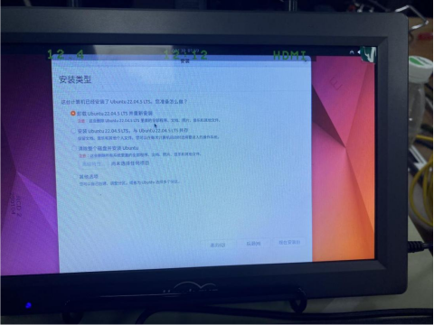
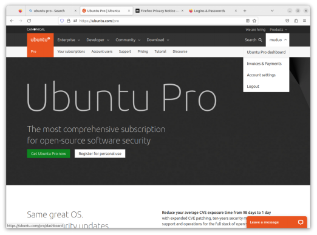
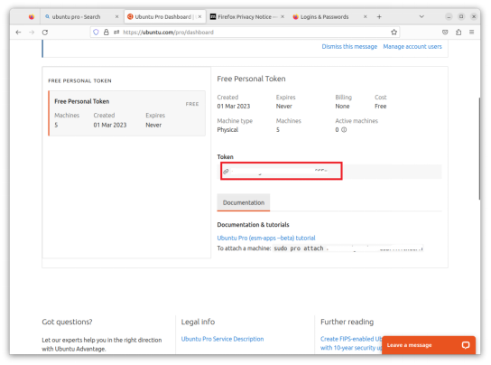
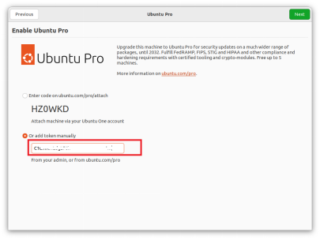

# ASEToolBox

<div align="left">
  
  
  
</div>

**A MATLAB/Simulink-based real-time simulation toolbox — deploy your Simulink model to an ASE-series real-time target machine in one click.**

---
> 📚 Document Navigation:<br>
> [Home (Hub)](https://github.com/zqkbd/flight-control-toolbox) | [中文](./README.md)<br>
> **This toolbox:** [中文](./README.md) | [English](./README_EN.md)<br>
> **Related toolbox:** [AFCToolBox — rapid flight-controller development](https://github.com/zqkbd/AFCToolBox) | [English](https://github.com/zqkbd/AFCToolBox/blob/main/README_EN.md)
---
## Contents

1. [Overview](#1-overview)
2. [Features](#2-features)
3. [System Architecture](#3-system-architecture)
4. [Requirements](#4-requirements)
5. [Quick Start](#5-quick-start)
6. [Setting Up the Target Machine](#6-setting-up-the-target-machine)
7. [Directory Structure](#7-directory-structure)
8. [FAQ](#8-faq)
9. [Authors and Contact](#9-authors-and-contact)

---
## 1. Overview

ASEToolBox is a real-time simulation toolbox developed by the ACG team on top of MATLAB/Simulink, designed to be used with ASE-series real-time target machines. Once you have built your model (`userModel.slx`) in Simulink, you only need to click the ASE menu in the Simulink window: the model is then automatically deployed, run, stopped and queried — no manual cross-compilation, file transfer or remote start-up required.

The complete source code of the toolbox is now officially open-sourced. Contributions, discussion and secondary development are welcome.
## 2. Features

1. **One-click auto deployment (AutoDeploy)** — automatically cross-compiles the Simulink model and deploys it to the real-time target machine.
2. **Run control** — start (`Run ASETarget`) and stop (`Stop ASETarget`) the simulation program from the ASE menu.
3. **Status query (Query)** — reads the run-time status of the simulation program on the target machine in real time.
4. **Hard real-time runtime** — Ubuntu 22.04 LTS with a PREEMPT-RT real-time kernel (5.15.0-1087-realtime).
5. **Multi-platform hardware support** — ADLINK industrial PCs and the EMB3118, EMB3942 and EMB4940 mainboards.
6. **Visual status feedback** — each deployment stage is reported in real time in the status bar at the bottom-left of the Simulink window.
## 3. System Architecture


## 4. Requirements

### Host PC (development machine)

| Software | Notes |
| --- | --- |
| Windows 10/11 | Traditional development host, full feature support |
| **Kylin V10 (Desktop)** | ✅ Domestic (Xinchuang) environment; the full MATLAB + Simulink chain works |
| **UOS V20 (Desktop)** | ✅ Domestic (Xinchuang) environment; the full MATLAB + Simulink chain works |
| MATLAB/Simulink | R2023a or later, used to build the user model and call ASEToolBox |
| MobaXterm / PuTTY | SSH access to the target machine from Windows |
| OpenSSH Client | Native SSH client on Kylin / UOS (pre-installed) |

### Target PC (ASE-1 real-time simulator)

| Item | Version |
| --- | --- |
| Operating system | Ubuntu 22.04.5 LTS Desktop |
| **Domestic OS** | **Kylin V10 SP1 (Server)** ✅ |
| Real-time kernel | 5.15.0-1087-realtime (Ubuntu Pro realtime-kernel) / native PREEMPT-RT kernel on Kylin |
| VSCode | 1.99 |
| GCC / G++ | 11.4.0 (build-essential) |
| GDB | 12.1 |
| Make | 4.3 |
| CMake | 3.22.1 |

## 5. Quick Start

### 5.1 Get and extract the project

Extract `ASEProject2.01.yymmdd.zip` to `D:\ASE\ASEProject` on the host PC.

### 5.2 Add the toolbox to the MATLAB path

Add the `ASEToolBox` directory and all of its subdirectories to the MATLAB search path:

```matlab
addpath(genpath('D:\ASE\ASEProject\ASEToolBox'));
savepath
```

You can also do this in MATLAB via **Home → Set Path → Add with Subfolders**.

### 5.3 Deploy ASETarget to the target machine

Log in to the target machine with MobaXterm and copy the whole `ASETarget` directory to:

```
/home/administrator/projects/
```

> **Note:** the `projects` folder must be created manually under `/home/administrator/` on the target machine. ASETarget must live in that directory for the ASE model to run correctly.

### 5.4 Run a simulation

1. Open your own model file `userModel.slx` in MATLAB/Simulink.
2. In the Simulink window, click the **ASE menu**:
   - **AutoDeploy** — deploy the model to the target machine automatically;
   - **Run ASETarget** — start the simulation program;
   - **Stop ASETarget** — stop the simulation program;
   - **Query** — query the run-time status.
3. Each stage's status is shown in the **status bar at the bottom-left** of the Simulink window (the font is small, so watch closely).

### 5.5 Notes when switching the host machine or network

When you move the network cable to a different computer (i.e. change the host machine), run one SSH connection from the host first — otherwise the subsequent flashing step may fail:

**Windows host:**

1. Press `Win + R`, type `cmd` and press Enter to open a command prompt.
2. Run:

```bash
plink -ssh administrator@192.168.0.7
```

**Kylin / UOS host** (using OpenSSH or the Linux build of putty-tools):

```bash
ssh administrator@192.168.0.7    # OpenSSH (prompts to confirm the host fingerprint on first connect)
# or
plink -ssh administrator@192.168.0.7   # plink from putty-tools on Linux
```

> Replace the IP address with the actual address of the target machine. The host and the target machine should be on the same subnet, e.g. `192.168.0.xx`.
## 6. Setting Up the Target Machine

The full installation procedure is summarized below.
### 6.1 Install Ubuntu 22.04

1. Download `ubuntu-22.04.5-desktop-amd64.iso` from the [Ubuntu website](https://releases.ubuntu.com/jammy/).



2. Create a bootable USB drive with Rufus (enable "List USB Hard Drives" and write in ISO mode).



3. Insert the drive into the target machine, press `DEL` / `F12` / `ESC` at boot to enter the BIOS, select `UEFI: Generic Flash Disk` and choose **Install Ubuntu**.



4. During installation:
   - Choose a city in mainland China as the region, so that the package sources are not pointed abroad and downloads do not fail;
   - Remove the installation USB drive before the machine reboots after installation.

### 6.2 Ubuntu installation options

(1) Enter the installer and choose **Install Ubuntu**.



(2) Click **Next**, then configure the language — Chinese or English, as you prefer.



(3) On the next page choose the normal installation.



(4) For the installation type, select the first option: erase Ubuntu 22.04.5 LTS and reinstall.



(5) Configure the Ubuntu account and password as required.

### 6.3 Configure a domestic package mirror and install SSH

Edit `/etc/apt/sources.list` and replace it with a domestic mirror:

```
deb https://mirrors.ustc.edu.cn/ubuntu/ jammy main restricted universe multiverse
deb https://mirrors.ustc.edu.cn/ubuntu/ jammy-updates main restricted universe multiverse
deb https://mirrors.ustc.edu.cn/ubuntu/ jammy-backports main restricted universe multiverse
deb https://mirrors.ustc.edu.cn/ubuntu/ jammy-security main restricted universe multiverse
```

Then install and start the SSH service:

```bash
sudo apt update
sudo apt install openssh-server
sudo systemctl start ssh
sudo systemctl enable ssh
```

### 6.4 Install the PREEMPT-RT real-time kernel (Ubuntu Pro)

The real-time kernel requires an Ubuntu Pro subscription (free for personal and small-scale commercial use on up to 5 machines):

1. Register an Ubuntu One account at [https://ubuntu.com/pro](https://ubuntu.com/pro), subscribe, and obtain a token.



2. Attach the machine on the target (via the first-boot wizard, or by entering the token in **Software & Updates → Livepatch**).





3. Enable and install the real-time kernel:

```bash
# Confirm the system is Ubuntu 22.04 LTS
lsb_release -a

# Enable the real-time kernel repository
sudo pro enable realtime-kernel --access-only
sudo apt update

# Install the specified real-time kernel (fall back to the ubuntu-realtime metapackage if unavailable)
sudo apt install -y linux-image-5.15.0-1078-realtime linux-headers-5.15.0-1078-realtime

# Configure GRUB to boot the real-time kernel by default
grep -E "^menuentry" /boot/grub/grub.cfg | cut -d "'" -f 2
sudo sed -i 's/^GRUB_DEFAULT=.*/GRUB_DEFAULT="Advanced options for Ubuntu>Ubuntu, with Linux 5.15.0-1078-realtime"/' /etc/default/grub
sudo update-grub
sudo reboot
```

4. Verify after rebooting:

```bash
uname -r                                     # should print 5.15.0-1078-realtime
grep PREEMPT_RT /boot/config-$(uname -r)     # should return CONFIG_PREEMPT_RT=y
grep CONFIG_HIGH_RES_TIMERS /boot/config-$(uname -r)   # should return =y
```

### 6.5 Install the development toolchain and VSCode

```bash
sudo apt install build-essential gdb cmake

# Install VSCode 1.99 (pinned version to avoid automatic upgrades)
wget https://update.code.visualstudio.com/1.99.0/linux-deb-x64/stable -O vscode_1.99.0_amd64.deb
sudo apt install ./vscode_1.99.0_amd64.deb
sudo apt-mark hold code
```

Then install the **C/C++**, **CMake Tools** and **CodeLLDB** (or Native Debug) extensions in VSCode.

### 6.6 Optional utilities

```bash
# Serial port monitor
sudo apt install cutecom
sudo usermod -a -G dialout $USER

# Chinese language pack and Fcitx input method
sudo apt-get install language-pack-zh-hans
sudo apt-get install fcitx fcitx-googlepinyin
```

### 6.7 Setting up a domestic OS target machine (Kylin V10 SP1)

Kylin V10 SP1 (Server) has been validated as an ASEToolBox target environment and serves as a domestic alternative to Ubuntu + PREEMPT-RT, with equivalent hard real-time performance.

**① System installation**

The Kylin V10 SP1 ISO is available from the Kylin website. Installation is similar to Ubuntu; note the following:

- The Server edition is recommended (it includes the PREEMPT-RT kernel packages);
- Leave room for `/home` when partitioning, as it hosts the `ASETarget` runtime;
- After installation, run `sudo apt update && sudo apt upgrade` to bring the system up to date.

**② Configure package sources and install SSH**

Configure the official Kylin sources or a domestic mirror:

```bash
# Back up and replace the package sources
sudo cp /etc/apt/sources.list /etc/apt/sources.list.bak
sudo tee /etc/apt/sources.list << 'EOF'
deb http://archive.kylinos.cn/kylin/KYLIN-ALL/ bionic main restricted universe multiverse
deb http://archive.kylinos.cn/kylin/KYLIN-ALL/ bionic-updates main restricted universe multiverse
deb http://archive.kylinos.cn/kylin/KYLIN-ALL/ bionic-security main restricted universe multiverse
EOF

sudo apt update
sudo apt install -y openssh-server
sudo systemctl enable ssh
sudo systemctl start ssh
```

**③ Install the PREEMPT-RT real-time kernel**

Kylin V10 SP1 ships its own PREEMPT-RT kernel packages — just install them (no Ubuntu Pro subscription needed):

```bash
# List available real-time kernels
apt-cache search kylin-realtime

# Install the real-time kernel (use the versions reported by the search)
sudo apt install -y linux-image-4.19.90-23.8.v2101.ky10.x86_64.realtime linux-headers-4.19.90-23.8.v2101.ky10.x86_64.realtime

# Update the GRUB configuration
sudo update-grub
sudo reboot
```

Verify after rebooting:

```bash
uname -r                                           # should contain "realtime"
grep PREEMPT_RT /boot/config-$(uname -r)          # should return CONFIG_PREEMPT_RT=y
```

**④ Install the development toolchain**

Kylin is based on Ubuntu 18.04, so some package names differ slightly from Ubuntu 22.04:

```bash
sudo apt install -y build-essential gdb cmake git

# Install GCC 9 (Kylin V10 ships an older default GCC; upgrading manually is recommended)
sudo apt install -y gcc-9 g++-9
sudo update-alternatives --install /usr/bin/gcc gcc /usr/bin/gcc-9 90
sudo update-alternatives --install /usr/bin/g++ g++ /usr/bin/g++-9 90
```

**⑤ Install VSCode**

The standard VSCode `.deb` package works on Kylin:

```bash
wget https://update.code.visualstudio.com/1.99.0/linux-deb-x64/stable -O vscode_amd64.deb
sudo dpkg -i vscode_amd64.deb
sudo apt --fix-broken install -y
```

**⑥ SSH client on the host (domestic OS or Windows)**

The ASEToolBox deployment scripts use `plink` (the PuTTY command-line tool) for SSH operations by default. On a domestic OS there are two alternatives:

- **Option A — use OpenSSH (recommended):** pre-installed on Kylin / UOS. Simply replace `plink` with `ssh` in the MATLAB path-switching script.
- **Option B — install putty-tools:** available directly from the domestic OS repositories:
  ```bash
  sudo apt install -y putty-tools   # provides the Linux build of the plink command
  ```
  Once installed, `plink` behaves exactly as it does on Windows.

**⑦ MobaXterm alternatives on the host**

On Kylin / UOS, the following tools can replace MobaXterm's SSH + SFTP functions:

| Function | Windows | Kylin / UOS |
| --- | --- | --- |
| SSH terminal | MobaXterm / PuTTY | **VSCode Remote SSH** / Termius / system `ssh` |
| SFTP file transfer | Built into MobaXterm | VSCode SFTP extension / **FileZilla** / `scp` |
| First-connect fingerprint confirmation | `plink -ssh ...` | `ssh administrator@<IP>` (prompts on first connect) |

> The ASEToolBox MATLAB deployment scripts already support the OpenSSH option: when an OpenSSH-based host is detected, the script switches the SSH client automatically.

---

## 7. Directory Structure

```
ASEProject/
├── ASEToolBox/        # MATLAB/Simulink toolbox (this repository)
│   ├── ...            # Simulink menu, deployment scripts, S-Functions, etc.
├── ASETarget/         # Target-machine runtime (copy to ~/projects/ on the target)
└── userModel.slx      # Example user model
```

> The layout above is for reference; refer to the actual release package.

## 8. FAQ

**Q: An SSH connection error appears when deploying / flashing the program.**

A: After changing the host machine or the network cable, run one SSH connection first so the host fingerprint is confirmed. On Windows use `plink -ssh administrator@<target-IP>`; on Kylin / UOS use `ssh administrator@<target-IP>` (OpenSSH) or the Linux `plink` (`sudo apt install putty-tools`).

**Q: Packages cannot be downloaded or installed.**

A: Check the network connection on the target machine and confirm that `/etc/apt/sources.list` has been replaced with a domestic mirror. When installing the OS, do not select a region outside mainland China (e.g. Hong Kong).

**Q: How do I confirm that the real-time kernel is active?**

A: `uname -r` should print `5.15.0-1087-realtime`, and `grep PREEMPT_RT /boot/config-$(uname -r)` should return `CONFIG_PREEMPT_RT=y`.

**Q: Where can I see the simulation status?**

A: The status bar at the bottom-left of the Simulink window reports every stage — deploy, run, stop. The font is small, so watch closely.

## 9. Authors and Contact

This project is developed and maintained by the ACG team at Sun Yat-sen University. If you have questions about the implementation, find a bug, or are interested in academic collaboration, please get in touch:

- **Email:** zqhkd@qq.com

---

- **Requirements:** MATLAB R2023a or later.
- **Copyright:** School of Aeronautics and Astronautics, Sun Yat-sen University. Licensed under the MIT License.